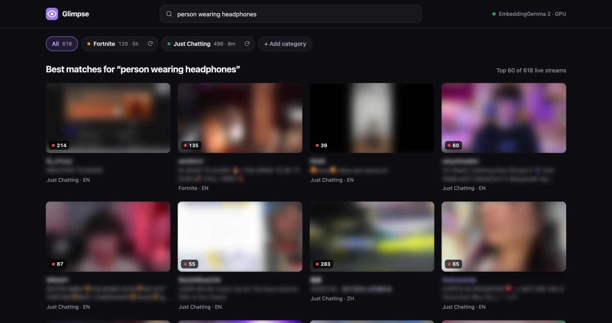

<p align="center">
  
</p>

<h1 align="center">Glimpse</h1>

<p align="center">
  <b>Search live Twitch streams by what's actually on screen.</b><br>
  Type “someone playing guitar” or “cat on camera” and Glimpse finds the live streams that look like it.
</p>

<p align="center">
  
  
  
  
</p>

<p align="center">
  
  <br>
  <sub>Thumbnails, names and stream titles are blurred here out of respect for the streamers.</sub>
</p>

## Why Glimpse?

Twitch lets you browse by category and search by stream title, but titles rarely say what's on screen. If you're
looking for someone cooking, a streamer with a cat on their desk, or a cosplay stream, you end up scrolling past
hundreds of thumbnails.

Glimpse looks at the thumbnails for you. Describe what you want to see in plain words and it shows you the live
streams that match best.

## How it works

<p align="center">
  
</p>

1. **Grab the live thumbnails.** Glimpse asks Twitch for the most-watched live streams in a category (say, the top
   100 in Just Chatting) and downloads their preview pictures.
2. **Turn each picture into a point on a map.** An AI model looks at each thumbnail and describes it as a list of 768
   numbers, which work like coordinates on a "map of meaning". Pictures that show similar things get similar numbers,
   so they land near each other: guitar streams in one neighborhood, cat streams in another.
3. **Put your words on the same map.** When you search, the same model reads your words and turns them into
   coordinates too. Because it learned pictures and words together, “someone playing guitar” lands right next to the
   guitar pictures.
4. **Show the closest pictures.** Glimpse measures how close your words are to every thumbnail and shows the closest
   first. No tags or keywords involved, only “what's nearby on the map”.

> It's like a library that shelves books by what they're *about* instead of alphabetically. Walk to the shelf for your
> topic, and everything around you is relevant.

<sub>In technical terms: thumbnails and text are embedded into a shared 768-dimensional vector space by
[EmbeddingGemma 2](https://huggingface.co/google/embeddinggemma-2), and results are ranked by cosine similarity.</sub>

## Get started

### What you'll need

- **Node.js 23.6 or newer.** Download it from [nodejs.org](https://nodejs.org).
- **A free Twitch developer app**, which lets Glimpse list live streams. Setup below takes about two minutes.
- **About 1 GB of disk space** for the AI model, downloaded automatically the first time.
- Any recent computer works. A Mac with Apple Silicon or a PC with a decent graphics card makes it much faster.

### 1. Download Glimpse

```bash
git clone https://github.com/petercunha/glimpse.git
cd glimpse
npm install
```

### 2. Add your Twitch keys

1. Go to the [Twitch developer console](https://dev.twitch.tv/console) and log in. Twitch requires two-factor
   authentication to be turned on for your account.
2. Click **Register Your Application** and fill in:
   - **Name:** anything, for example `Glimpse (your name)`
   - **OAuth Redirect URL:** `http://localhost`
   - **Category:** Application Integration
   - **Client Type:** Confidential
3. Open the app with **Manage**, copy the **Client ID**, then click **New Secret** and copy the secret.
4. Make your own settings file from the example and paste both values into it:

   ```bash
   cp .env.example .env
   ```

   ```
   TWITCH_CLIENT_ID=paste_your_client_id_here
   TWITCH_CLIENT_SECRET=paste_your_client_secret_here
   ```

Your keys stay on your computer. The `.env` file is never uploaded to GitHub.

### 3. Start it

```bash
npm start
```

Open **<http://localhost:3737>**. The very first launch downloads the AI model (about 900 MB), which can take a few
minutes. After that it starts in seconds.

### 4. Scan a category and search

Pick a category on the welcome screen, such as Just Chatting or Fortnite. Glimpse scans the top 50 live streams
(about 20 seconds), then you can start typing.

## Using Glimpse

| Feature | How it works |
| --- | --- |
| 🔍 **Search** | Describe what you want to see. Results update as you type. Press <kbd>/</kbd> to jump to the search box and <kbd>Esc</kbd> to clear it. |
| 📺 **Browse** | Leave the search box empty to see everything that's live, most viewers first. |
| 🏷️ **Filter** | Click category chips to search only those categories. Click **All** to search everything. |
| ➕ **Add a category** | **+ Add category** takes a name (“League of Legends”) or a Twitch link. Choose how many streams to scan and, optionally, a language. |
| 🔄 **Rescan** | Thumbnails go stale quickly, so a chip's dot turns amber after 30 minutes. Click its ↻ button to rescan or to change how many streams it covers (up to 500). |

**Search ideas:** someone playing guitar · person wearing headphones · cat on camera · cosplay · cooking ·
walking around a city at night · two people on a couch · guy wearing a green shirt

## Good to know

**Does it send my data anywhere?**
No. Everything runs on your computer. Glimpse only talks to Twitch (to list live streams and download thumbnails) and,
the first time, to Hugging Face (to download the AI model). Your searches never leave your machine.

**How fresh are the results?**
Each scan is a snapshot. Twitch refreshes thumbnails about every 5 minutes and streams start and end all the time, so
rescan when a chip's dot turns amber.

**How accurate is it?**
It's good at objects, activities, settings and colors, but it's the model's best guess and it can be wrong. Small
details are harder, like a tiny face cam in the corner of a game. Descriptions of how someone looks are guesses too.

**How fast is it?**
On an Apple M1 Max, scanning takes about 0.4 seconds per thumbnail (50 streams in about 20 seconds) and a search
takes about 50 milliseconds. Glimpse uses your graphics card when it can and falls back to the processor, which is
about 9× slower, when it can't.

**Does it re-analyze pictures it has already seen?**
No. Glimpse saves a fingerprint (SHA-256 hash) of every thumbnail, and identical pictures reuse their saved result.
Since Twitch refreshes thumbnails every 5 minutes, this mostly speeds up rescans done shortly after a scan.

**Is Glimpse affiliated with Twitch?**
No. It's an independent project that uses Twitch's public API.

## Command line (optional)

Everything the web app does also works from the terminal. Run `npm link` once to make the `glimpse` command available
everywhere (or use `./bin/glimpse.js` inside this folder).

```bash
glimpse index just-chatting --limit 100       # scan the top 100 live streams in a category
glimpse index fortnite "League of Legends" --lang en
glimpse search "guy wearing a green shirt"     # search everything you've scanned
glimpse search "cat on camera" --open          # see the results as a thumbnail page in your browser
glimpse list                                   # what's scanned, and how long ago
glimpse serve --open                           # start the web app
```

| Option | What it does |
| --- | --- |
| `--limit <n>` | Streams per category (default 50). |
| `--lang <code>` | Only streams in one language, e.g. `en`. |
| `--detail <70…1120>` | How closely the model looks at each picture. Higher catches smaller things but is slower. Default 280. |
| `--size <WxH>` | Thumbnail size to download (default `640x360`). |
| `--device <webgpu\|cpu>` | Where the model runs. Default `webgpu` (your graphics card), falling back to CPU if needed. |
| `--no-refresh` | Re-analyze the saved thumbnails instead of scanning Twitch again. |
| `--no-cache` | Re-analyze every thumbnail, even ones seen before. |

### Comparing AI models

Glimpse ships with two models: [EmbeddingGemma 2](https://huggingface.co/google/embeddinggemma-2), Google's new
multimodal model and the default, and [SigLIP 2](https://huggingface.co/google/siglip2-so400m-patch14-384), a proven
model built specifically for searching images by text. To see which works better for you:

```bash
glimpse index just-chatting --model all
glimpse compare "guy wearing a green shirt" "cat on camera" "cooking"
```

This opens a page with each model's top matches side by side.

## For developers

- **TypeScript everywhere, no build step.** Node runs the server's TypeScript directly, and the browser code
  (`web/app.ts`) is served with its types stripped by [amaro](https://github.com/nodejs/amaro). `npm run typecheck`
  checks both.
- **AI:** [Transformers.js](https://huggingface.co/docs/transformers.js) running ONNX models through ONNX Runtime,
  on the GPU via WebGPU. The web server keeps the model loaded and scans in small batches, so searches stay fast even
  during a scan.
- **Twitch:** the official [Helix API](https://dev.twitch.tv/docs/api/) with an app access token.
- **Storage:** no database. Each category is a folder of plain files:

  ```
  data/categories/just-chatting/
    snapshot.json          streams, titles, viewer counts, thumbnail hashes
    thumbs/*.jpg           the thumbnails
    embeddings/gemma.f32   one vector per thumbnail (raw float32), plus gemma.json with details
  ```

```
src/cli.ts         command-line interface
src/server.ts      web server: page, search API, background scans
src/indexer.ts     scanning a category (shared by the CLI and server)
src/library.ts     reading what's been scanned
src/twitch.ts      Twitch API client
src/embedders.ts   EmbeddingGemma 2 and SigLIP 2
src/search.ts      ranking by cosine similarity
src/store.ts       saving and loading scans and embeddings
src/report.ts      HTML results pages for the CLI
src/api-types.ts   web API types, shared with the browser code
web/               the web page (index.html, style.css, app.ts)
```

## Credits

- [EmbeddingGemma 2](https://huggingface.co/google/embeddinggemma-2) by Google DeepMind and
  [SigLIP 2](https://huggingface.co/google/siglip2-so400m-patch14-384) by Google, via the
  [ONNX community](https://huggingface.co/onnx-community) conversions.
- [Transformers.js](https://github.com/huggingface/transformers.js) by Hugging Face and
  [ONNX Runtime](https://onnxruntime.ai).
- Live stream data from the [Twitch API](https://dev.twitch.tv/docs/api/).

## License

[MIT](LICENSE) © Peter Cunha
